# Foldy

### 찾고, 옮기고, 정리하는 일을 한 창에서 빠르게.

- **검색**은 0.003초
- **느린 드라이브**는 알아서 가볍게
- **Git 상태**는 폴더에 들어가는 순간 보이고
- **폴더 분석**은 공간을 잡아먹는 폴더를 짚어 주고
- **폴더 템플릿**은 Java·Python 같은 프로젝트 구조를 버튼 한 번에

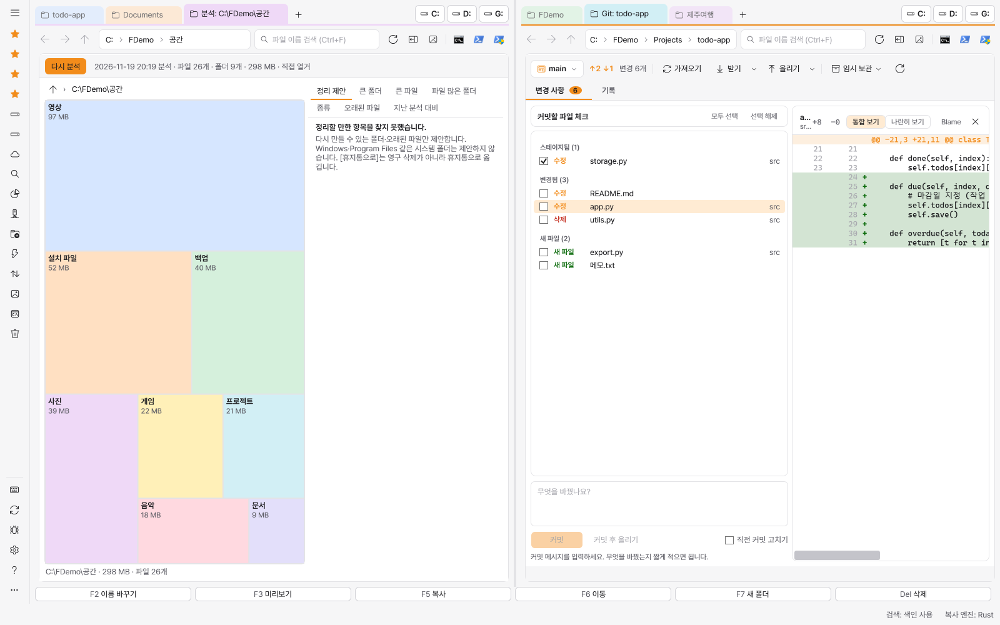

*(이 문서의 모든 화면은 가짜 샘플 폴더로 찍은 실제 Foldy 화면입니다. 개인 정보는 들어 있지 않습니다.)*

**[⬇ 최신 버전 내려받기 (MSI)](https://github.com/chadolkr/Foldy-releases/releases/latest)** · Windows 10/11 x64 · 무료(프리웨어)

## 이런 게 좋아요

- ⚡ **치는 순간 찾아요.** 내 PC의 파일 217만 개 중에서 이름 검색이 **0.003초**. 기다릴 틈이 없어요. *(노트북 실측)*
- 🐢➡️🐇 **느린 드라이브도 알아서 척척.** 폴더를 열 때마다 속도를 재서, 회사 보안 드라이브처럼 느린 곳은 스스로 알아채요. 목록부터 바로 보여 주고 무거운 일은 뒤로 미뤄서 절대 멈추지 않아요. 설정할 것도 없어요.
- 📊 **용량 범인 한눈에.** 폴더 분석을 누르면 어떤 폴더가 공간을 잡아먹는지 큼직한 상자 그림으로 보여 주고, 지워도 되는 것(임시 파일·빌드 결과 등)까지 골라 줘요. 휴지통 용량도 보고 바로 비울 수 있어요.
- 🧊 **10만 개 폴더도 0.03초.** 아무리 큰 폴더도 눈 깜짝할 새 열려요.
- 🏀 **복사가 재밌어요.** 빠른 병렬 복사가 도는 동안 연주와 우진이 농구를 해요. 다 끝나면 3점슛!
- 🪟 **두 창이 나란히.** 왼쪽에서 오른쪽으로 끌어 놓거나 F5 한 번이면 복사 끝. 탭은 색깔별로, 열어 둔 폴더는 다음에도 그대로.
- 👀 **열지 않고 봐요.** F3을 누르면 사진·문서·코드·PDF가 목록 위에 바로 떠요.
- 🌿 **Git이 알아서 켜져요.** 프로젝트 폴더에 들어가면 브랜치·변경 수가 보이고, 클릭 몇 번으로 커밋·올리기.
- 🌐 **서버 폴더도 내 폴더처럼.** SFTP 서버를 탭으로 열고 끌어 놓기로 올리고 내려받아요.
- 🗂️ **정리는 맡겨 주세요.** 다운로드 폴더를 종류·날짜별로 한 번에 정리(되돌리기 가능), Java·Python·PARA 등 15가지 폴더 구조를 클릭 한 번에.
- 🔄 **업데이트는 신경 끄세요.** 회사 프록시 뒤에서도 알아서 확인하고, 하던 작업이 끝난 뒤에 설치해요.

## 목차

- [이런 게 좋아요](#이런-게-좋아요)
- [핵심 원칙](#핵심-원칙)
- [설치](#설치)
- [패널과 탭](#패널과-탭)
- [사이드바](#사이드바)
- [파일 작업과 복사 엔진](#파일-작업과-복사-엔진)
- [검색과 색인 서비스](#검색과-색인-서비스)
- [미리보기](#미리보기)
- [이미지만 보기](#이미지만-보기)
- [Markdown 보기](#markdown-보기)
- [Git](#git)
- [SFTP와 SSH](#sftp와-ssh)
- [폴더 템플릿·위저드·정리](#폴더-템플릿위저드정리)
- [폴더 분석](#폴더-분석)
- [느린 드라이브](#느린-드라이브)
- [설정과 테마](#설정과-테마)
- [단축키](#단축키)
- [버그 신고와 버그 진단 모드](#버그-신고와-버그-진단-모드)
- [자주 묻는 질문](#자주-묻는-질문)
- [개인정보](#개인정보)
- [라이선스](#라이선스)

## 핵심 원칙

- **빠르다**: 화면을 그리는 스레드에서는 디스크를 읽지 않습니다. 드라이브마다 작업 줄이 따로 있고, 큰 목록은 직접 그리며, 색인과 복사는 Rust 엔진이 맡습니다. 응답 없는 네트워크 드라이브가 있어도 다른 탭은 그대로 움직입니다.
- **안정적이다**: 색인·업데이트는 별도 프로세스(서비스)에서 돌고, 엔진 호출 오류가 앱을 죽이지 못하게 막고, 엔진이 없으면 기본 경로로 대신합니다. 복사 중에도 다른 폴더를 마음대로 볼 수 있습니다.
- **단순하다**: 탐색기와 같은 동작(우클릭 메뉴, 끌어 놓기, 키 조작)을 그대로 두고, 모달 창 대신 제자리에서 진행 상황을 보여 줍니다. **복잡한 기능은 만들지 않습니다.** 설정은 꼭 필요한 것만 있습니다.
- **다양한 기능**: 듀얼 패널·탭, 즉시 검색, 폴더 분석, Git, SFTP/SSH, 터미널, Markdown 뷰어, 폴더 템플릿·정리.

## 설치

[Releases](https://github.com/chadolkr/Foldy-releases/releases)에서 받습니다.

| 방법 | 파일 | 설명 |
| --- | --- | --- |
| **MSI (권장)** | `Foldy-<버전>-x64.msi` | 더블클릭해 설치합니다. 제거는 Windows 설정 → 앱 → 설치된 앱 → Foldy → 제거. |
| 스크립트 설치 | `Foldy-<버전>-x64-setup.zip` | 압축을 풀고 `Foldy 설치.cmd`를 실행합니다. 제거는 같은 폴더의 `Foldy 제거.cmd`. MSI로 설치한 경우 덮어쓰지 않습니다. |

설치하면 빠른 파일 검색을 위한 **색인 서비스**(FoldyIndexer, SYSTEM 권한)가 함께 설치되고, 제거할 때 함께 지워집니다.

### 자동 업데이트

- 실행 5초 뒤와 6시간마다 GitHub Releases에서 새 버전을 확인합니다. 새 버전은 **Ed25519 서명과 해시를 확인한 뒤에만** 설치합니다. 상태바 오른쪽에 "Foldy x.y.z · 재시작하고 업데이트"가 나타납니다.
- 색인 서비스가 있으면 **관리자 확인 창 없이**(UAC 없음) 설치하고 Foldy를 다시 띄웁니다. 복사·이동 중에 누르면 작업을 끊지 않고 예약했다가 모두 끝나면 설치합니다.
- **회사 프록시**: 서비스(SYSTEM)는 사용자별 프록시(PAC 스크립트 등)를 못 씁니다. 서비스가 확인에 실패하면 Foldy가 **사용자 권한과 Windows 사용자 프록시 설정으로** 직접 확인·다운로드합니다. 이 경우 설치할 때 관리자 확인이 한 번 필요합니다. 서명·해시 검사는 똑같습니다.
- 사이드바 아래 **업데이트** 버튼(또는 더 보기 → 업데이트 확인)은 바로 확인하고, 실패하면 이유를 보여 줍니다.

## 패널과 탭

맨 왼쪽 **사이드바**, 그 오른쪽에 **왼쪽·오른쪽 두 패널**이 있습니다. 지금 조작하는 패널(활성 패널)은 탭 아래에 강조색 선이 보이고 **Tab** 키로 반대 패널로 옮겨 갑니다.

패널 하나는 위에서부터 이렇게 생겼습니다.

1. **탭 줄**: 폴더마다 색이 다른 탭(OneNote처럼). 오른쪽 끝은 드라이브 바로가기.
2. **경로바**: 경로 조각을 누르면 그 폴더로, 빈 곳을 누르거나 **Ctrl+L**이면 직접 입력. Git 저장소 안이면 브랜치 칩(`main ↑2 ↓1`)이 보입니다.
3. **검색칸**(**Ctrl+F**)과 도구 버튼(새로 고침, 폴더 트리, 이미지만 보기, 터미널).
4. **트리 | 목록**: 왼쪽은 폴더 트리, 오른쪽은 파일 목록. 가운데 경계선을 끌면 트리 너비가 바뀌고 **Ctrl+B**로 숨깁니다.
5. 아래쪽에 **작업 패널**, **파일 작업 버튼 줄**(F2·F3·F5·F6·F7·Del), **상태바**.

| 하고 싶은 것 | 방법 |
| --- | --- |
| 새 탭 / 탭 닫기 | **Ctrl+T** / **Ctrl+W** (가운데 버튼 클릭, 탭의 ✕) |
| 다음/이전 탭 | **Ctrl+Tab** / **Ctrl+Shift+Tab** |
| 순서 바꾸기, 반대 패널로 옮기기 | 탭을 끌어서 다른 탭(또는 반대 패널의 탭) 위에 놓기 |
| 같은 폴더를 새 탭으로 | 탭을 두 번 클릭 |
| 뒤로 / 앞으로 / 위로 | **Alt+←** / **Alt+→** / **Alt+↑** (마우스 뒤로·앞으로 버튼) |

탭·경로·정렬·창 위치는 자동으로 저장되어 다음 실행 때 그대로 복원됩니다. Foldy는 **한 번에 하나만** 뜹니다. 이미 켜져 있을 때 다시 실행하면 그 창이 앞으로 오고, 폴더를 넘겼다면 새 탭으로 열립니다.

## 사이드바

맨 위 **≡**(또는 **Ctrl+Shift+B**)로 접으면 아이콘만 남습니다. **Ctrl+Shift+E**로 키보드 포커스를 옮겨 Tab으로 둘러볼 수 있습니다.

- **자주 쓰는 폴더(빠른 접근)**: 제목 옆 핀 버튼으로 지금 폴더를 고정합니다. 누르면 활성 패널에서 열리고, 오른쪽 클릭으로 새 탭·반대 패널에서 열기, 순서 바꾸기, 고정 해제.
- **최근 폴더**: 최근에 연 폴더 5개가 자동으로 쌓입니다(고정한 폴더는 빠짐).
- **드라이브**: 이름, 사용량 막대, 남은 공간. 90% 넘게 차면 막대가 빨갛게 바뀝니다. 오른쪽 클릭으로 폴더 분석을 바로 시작합니다. Google Drive for desktop의 드라이브(G:)는 구름 아이콘으로 보입니다.
- **도구**: 파일 검색, 폴더 분석, SFTP 연결, 템플릿으로 새 폴더, 폴더 위저드, 이 폴더 정리, 이미지만 보기, 터미널.
- **휴지통**: 쌓인 용량이 보이고(예: 휴지통 · 38 GB), 누르면 Windows 휴지통이 열립니다. **비우기**는 확인을 한 번 거쳐 모든 드라이브의 휴지통을 비웁니다.
- **맨 아래 줄**: 모든 명령(**Ctrl+Shift+P**), 업데이트, 버그 신고, 설정(**Ctrl+,**), 도움말(**F1**), 더 보기(테마, 숨김 파일, 목록 간격, 색인 서비스, Foldy 정보).

사이드바 아래의 **명령 팔레트**는 이름 일부만 쳐도 모든 명령을 찾아 실행합니다.

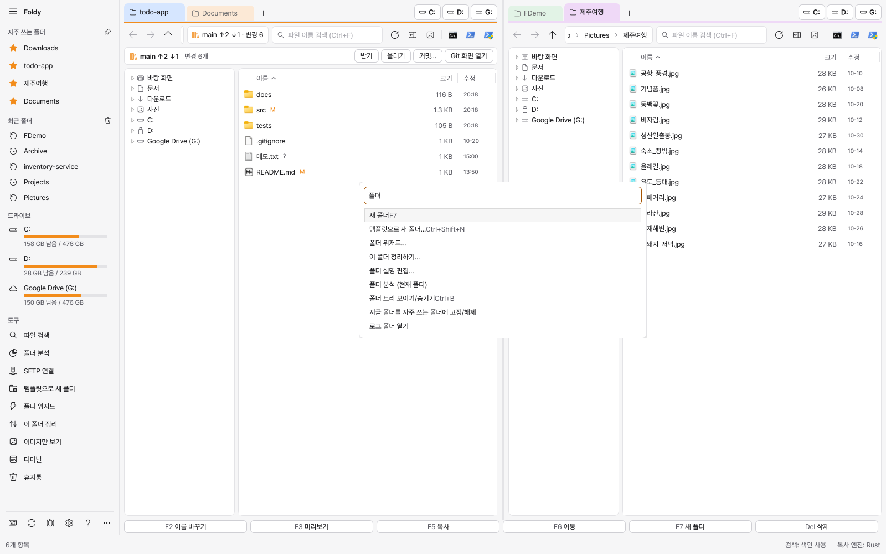

## 파일 작업과 복사 엔진

| 작업 | 키 | 설명 |
| --- | --- | --- |
| 이름 바꾸기 | **F2** | 확장자를 뺀 이름이 선택된 채로 입력칸이 열립니다 |
| 복사 / 이동 | **F5** / **F6** | 선택한 항목을 반대 패널의 폴더로 |
| 새 폴더 | **F7** | 만들자마자 이름을 입력할 수 있습니다 |
| 휴지통으로 / 영구 삭제 | **Delete** / **Shift+Delete** | 영구 삭제는 확인 창이 뜹니다 |
| 복사·잘라내기·붙여넣기 | **Ctrl+C / X / V** | 탐색기와 주고받을 수 있습니다 |

- **우클릭**하면 탐색기와 똑같은 메뉴(연결 프로그램, 보내기, 압축 등)가 뜹니다. **Shift+우클릭**은 확장 메뉴.
- **끌어 놓기**: 탐색기와 주고받을 수 있습니다. 같은 드라이브면 이동, 다른 드라이브면 복사가 기본이고 **Shift**는 이동, **Ctrl**은 복사.
- 글자를 입력하면 그 이름으로 시작하는 파일로 바로 이동합니다(Type-ahead).
- 복사와 이동은 **Rust 병렬 복사 엔진**이 맡습니다(상태바에 "복사 엔진: Rust"). 같은 이름이 있으면 "둘 다 유지 / 덮어쓰기 / 건너뛰기"를 묻고 나머지에도 똑같이 적용할 수 있습니다. 진행 상황은 작업 패널과 작업 표시줄에 보입니다. 

### 연주와 우진

1.5초 넘게 걸리는 작업에는 작업 패널에 농구하는 두 아이 **연주**와 **우진**이 나타납니다. 복사·이동은 패스하고 드리블하며 진행되는 만큼 나아가다가 끝나면 3점슛 성공 후 하이파이브, 삭제는 공을 휴지통에 던지고, 검색·네트워크 대기는 두리번거리며 공을 찾고, 실패하면 슛이 림을 맞고 튕겨 나갑니다. 설정에서 끌 수 있고, 창이 최소화되거나 가려지면 멈춰서 CPU를 쓰지 않습니다.

## 검색과 색인 서비스

**Ctrl+F**로 검색칸에 이름 일부를 입력하고 Enter를 누르면 **검색 결과 탭**이 열립니다. 결과에서 폴더를 열면 새 폴더 탭이, 파일은 바로 열립니다. **Esc**는 검색 취소.

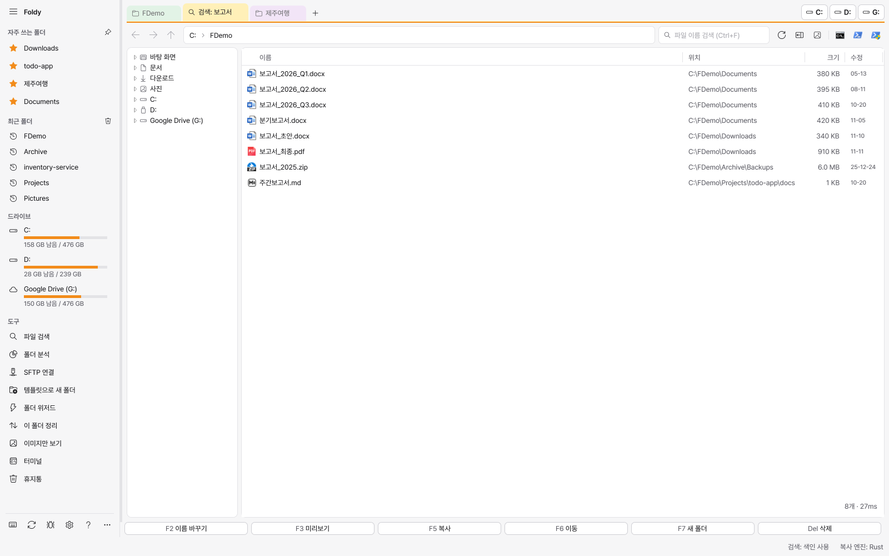

- **색인 서비스**가 설치돼 있으면 NTFS 색인(MFT·USN 저널)으로 전체 드라이브를 즉시 검색합니다. 서비스를 다시 시작해도 저장된 색인을 읽고 변경분만 따라잡습니다. 상태바에 "검색: 색인 사용".
- 서비스가 없으면 현재 폴더 아래를 직접 훑습니다(상태바 "폴더 훑기").
- 서비스는 사이드바 더 보기 → **색인 서비스 설치 (관리자)…** 로 설치하고, MSI·스크립트 설치에는 처음부터 들어 있습니다. 같은 서비스가 폴더 크기, 폴더 분석, 업데이트도 도와줍니다. 

## 미리보기

**F3**(또는 아래쪽 **F3 미리보기**)을 누르면 파일 목록 **위쪽**에 미리보기 창이 열리고(파일 이름이 잘리지 않게), 목록에서 고른 파일을 바로 보여 줍니다. 경계선을 끌어 높이를 바꿉니다.

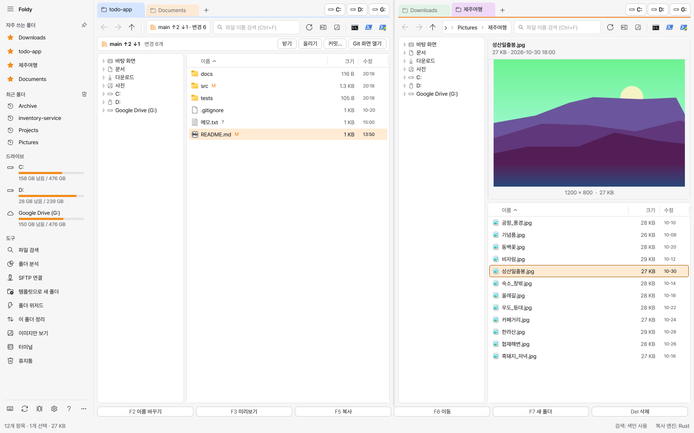

Markdown, 이미지, 텍스트·코드(문법 강조), PDF·Office처럼 Windows 미리보기 처리기가 있는 형식을 지원합니다.

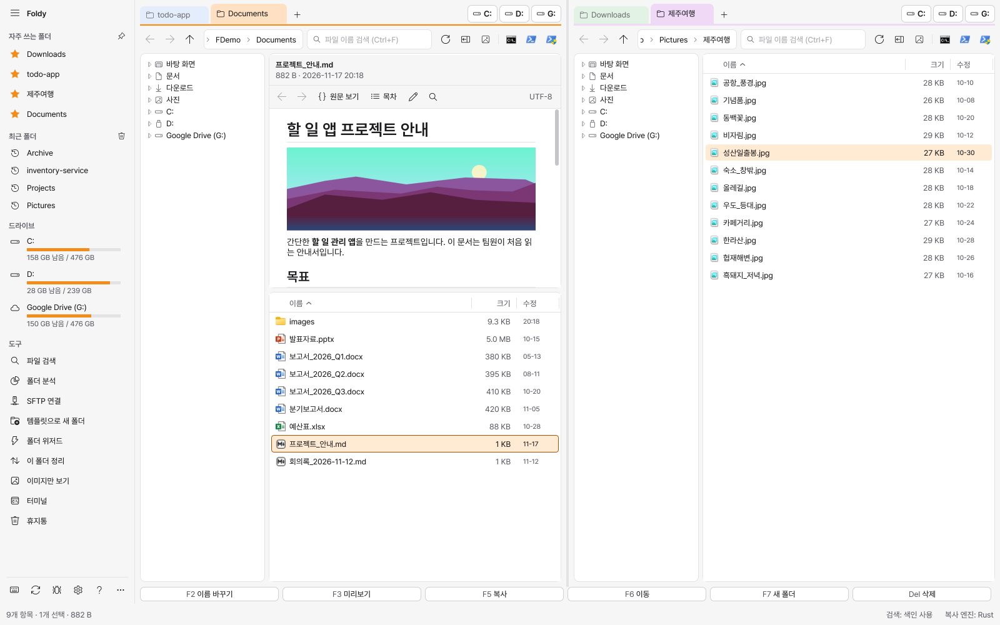

클라우드 전용 파일, 네트워크 드라이브, SFTP는 느려지거나 내려받기가 시작되지 않게 자동으로 읽지 않고 **[미리보기]**를 눌렀을 때만 읽습니다. 

## 이미지만 보기

**Ctrl+Shift+I** 또는 도구 버튼(그림 아이콘)으로 현재 폴더의 이미지만 썸네일 격자로 봅니다. 다른 파일은 숨길 뿐 움직이지 않습니다.

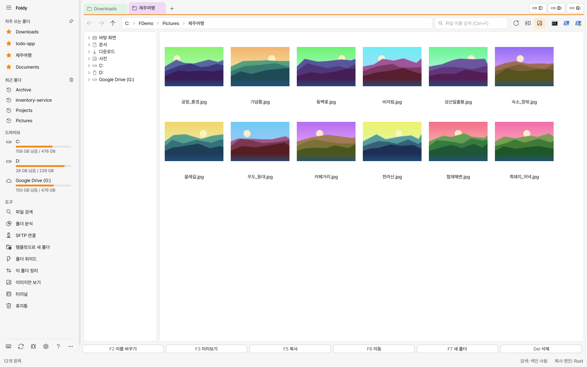

**스페이스**: 크게 보기(← →, 휠 확대, R 회전, Esc), **Ctrl+휠**: 썸네일 크기. 네트워크·클라우드 드라이브는 내용을 읽지 않습니다. 

## Markdown 보기

`.md` 파일을 열 때 연결된 앱이 없으면(또는 설정에서 "항상 Foldy 뷰어") Foldy 안의 탭에서 바로 보여 줍니다. 표, 체크박스, 코드(문법 강조·복사 버튼), 상대 경로 그림, 목차, **Ctrl+F** 문서 내 찾기를 지원합니다. 문서 안의 `.md` 링크는 같은 탭에서 열리고(뒤로/앞으로), 폴더 링크는 폴더 탭으로 열립니다. 인터넷 그림은 [이미지 불러오기]를 눌러야만 받습니다. 이 사용 설명서(**F1**)도 같은 뷰어입니다.

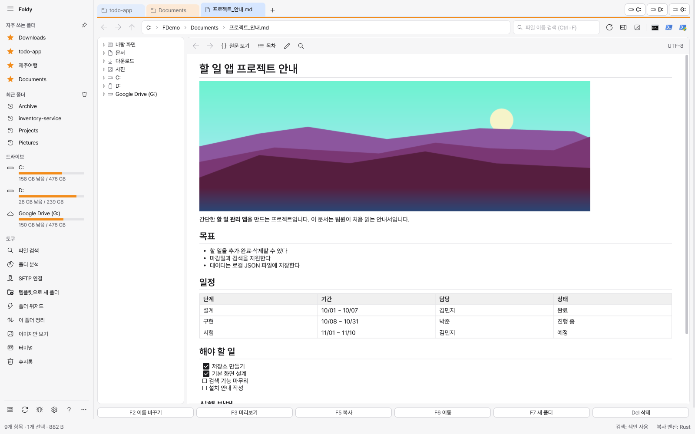

## Git

Git 저장소 폴더에 들어가면 Git이 저절로 켜집니다. Git for Windows가 설치돼 있어야 합니다.

- **Git 바**: 파일 목록 위의 얇은 줄. 브랜치, 올릴/받을 커밋 수(↑↓), 변경 개수와 **받기 / 올리기 / 커밋… / Git 화면 열기**. 받기·올리기는 화면을 옮기지 않고 실행하고 결과를 상태바에 알립니다.
- 목록의 변경 표시: **M** 수정, **A** 추가, **?** 추적 안 함, **!** 충돌, 무시된 파일은 흐리게.
- 설정 → 일반 → Git: "Git 바 보이기", "Git 저장소 폴더에서 Git 화면 자동 열기".

### 변경 사항과 diff

Git 화면의 **변경 사항** 탭: 커밋할 파일의 체크박스를 켜고(스테이지), 파일을 누르면 오른쪽에 바뀐 내용(diff: 추가 초록·삭제 빨강, 통합/나란히 보기)이 보입니다. 아래에 메시지를 쓰고 **커밋** 또는 **커밋 후 올리기**. 임시 보관(stash), 브랜치 전환·만들기도 위쪽 줄에서 합니다.

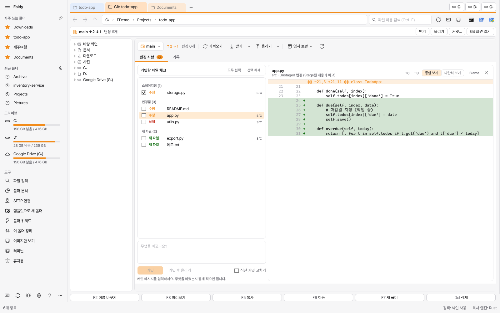

### Blame

파일을 우클릭해 **이 파일 Blame**을 고르거나(또는 명령 팔레트의 "Git: 이 파일 Blame") diff 머리글의 **Blame** 버튼. 줄마다 해시·작성자·날짜가 보이고, 해시를 누르면 기록 탭에서 그 커밋이 선택됩니다.

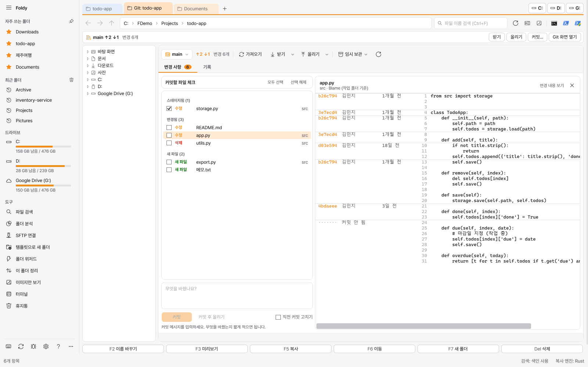

### 기록(History)

**기록** 탭: 브랜치 그래프와 커밋 목록(메시지·작성자·해시 검색). 커밋을 누르면 바뀐 파일이, 파일을 누르면 그 커밋에서 바뀐 내용이 보입니다.

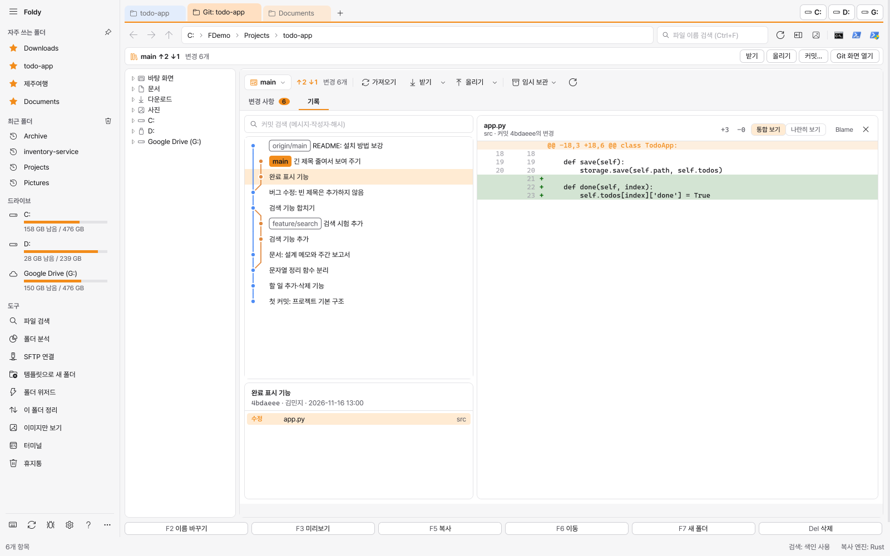

저장소가 아닌 폴더에서는 "여기에 Git 저장소 만들기" 버튼이 나옵니다. 강제 올리기는 `--force-with-lease`만 쓰고 경고를 거칩니다. 

## SFTP와 SSH

**Ctrl+Shift+O**(또는 사이드바의 **SFTP 연결**)로 서버에 접속하면 SFTP 폴더가 탭으로 열립니다.

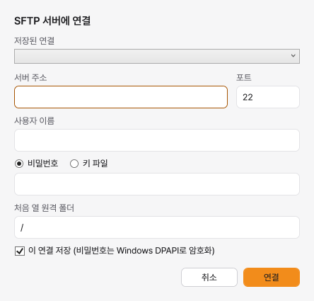

- 비밀번호 또는 키 파일 인증. "이 연결 저장"을 켜면 비밀번호는 Windows DPAPI로 암호화해 저장합니다. `~/.ssh/config`의 Host 항목도 저장된 연결에 나옵니다.
- 처음 보는 서버는 호스트 키 지문을 보여 주고 묻습니다(known_hosts는 OpenSSH와 같이 씀). 키가 바뀌었으면 경고합니다.
- 로컬 ↔ SFTP **복사·이동·끌어 놓기·붙여넣기**가 양방향으로 됩니다. 덮어쓸 때도 임시 파일에 끝까지 쓴 뒤 바꿔 넣으므로 실패해도 기존 파일은 그대로입니다. 이동은 복사가 모두 성공한 뒤에 원본을 지웁니다.
- SFTP에는 휴지통이 없어 삭제 전에 한 번 더 묻습니다.
- SFTP 탭에서는 터미널 버튼이 **SSH**로 바뀌어 같은 서버·폴더로 열립니다. 

## 폴더 템플릿·위저드·정리

사이드바의 도구(또는 **Ctrl+Shift+P**)에서 엽니다.

### 템플릿으로 새 폴더 (Ctrl+Shift+N)

폴더 구조를 한 번에 만듭니다. 오른쪽에서 만들어질 트리를 미리 보고 필요 없는 폴더는 체크를 풀 수 있고, 이미 있는 폴더는 건드리지 않고 없는 것만 만듭니다. 각 스타일의 **사용법**도 볼 수 있습니다. 묶음별 내장 템플릿:

- **개인·업무**: PARA, Johnny.Decimal, 고객·프로젝트 업무, 문서 작성 단계, 연구·학습, 생활·가정 서류
- **개발**: 소프트웨어 프로젝트(일반), **Java(Maven·Gradle)**, Python, Node·TypeScript, .NET 솔루션, Go
- **미디어·창작**: 사진·영상 보관, 디자인·창작 자산
- **기록·보관**: 날짜별 보관함

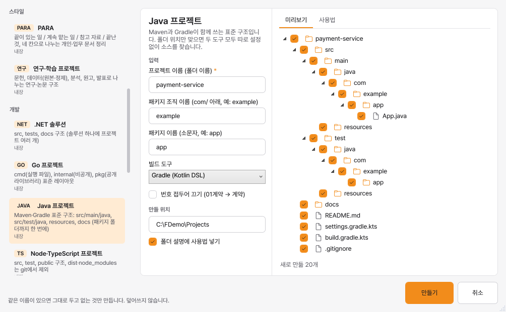

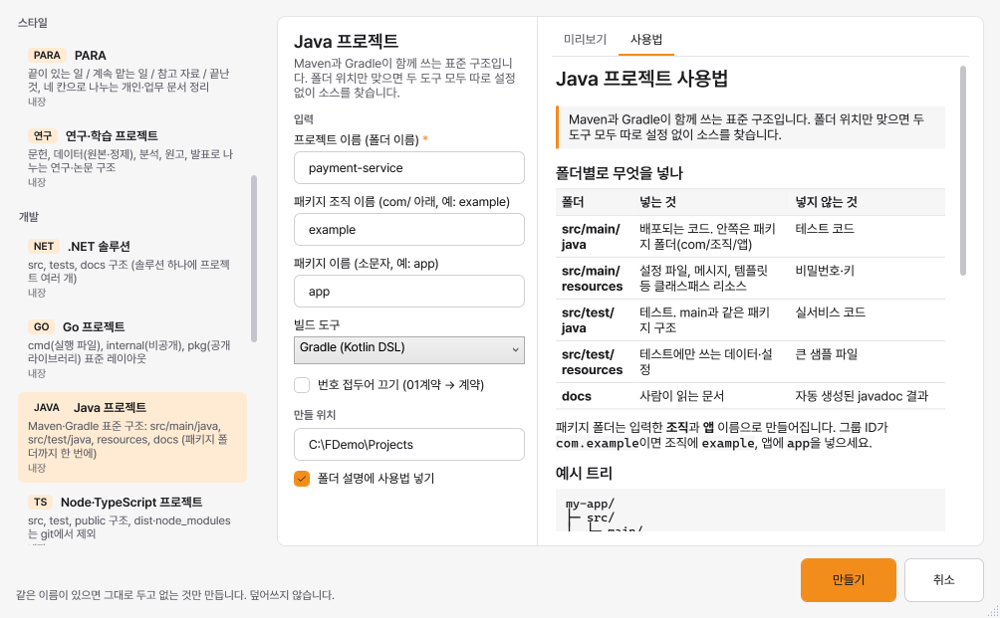

### 폴더 위저드

용도(개인·업무·개발 등)를 고르고, 몇 가지 질문(개발이면 **사용 언어**)에 답하면 알맞은 스타일을 추천하고 같이 맞춰 만듭니다. "정리가 필요해요"를 고르면 정리 창으로 이어집니다.

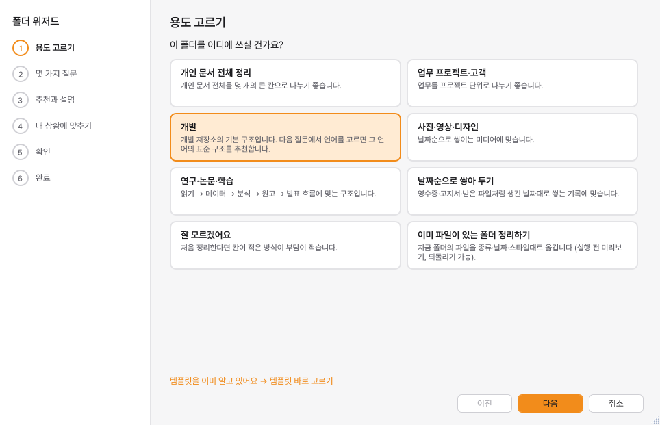

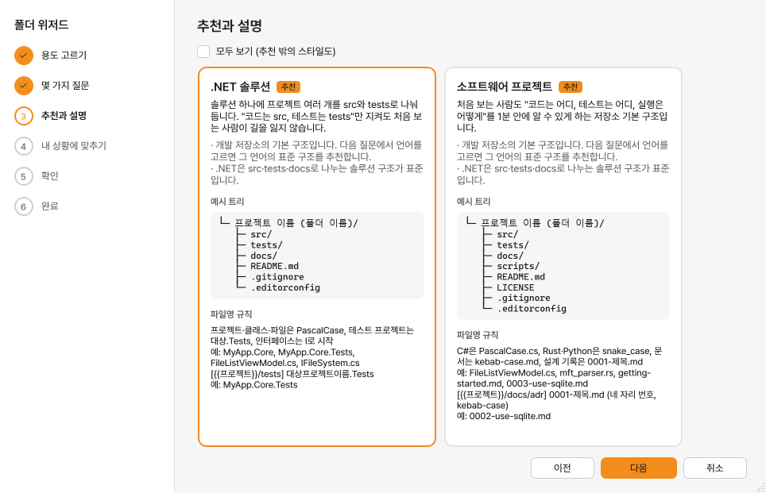

### 이 폴더 정리하기

다운로드·바탕 화면처럼 어지러운 **일반 폴더**를 종류별·날짜별·스타일대로·직접 규칙으로 옮겨 줍니다.

1. 정리 방식을 고르고 **계획 만들기**를 누르면 "지금 → 정리 후"가 트리로 보입니다. 같은 내용의 파일은 "_중복 후보"로 모읍니다.
2. 옮길 파일 목록에서 항목마다 체크를 풀거나 폴더 이름을 고칠 수 있습니다.
3. **정리하기**를 누릅니다. **아무것도 삭제하지 않으며**, **되돌리기** 한 번으로 원래대로 돌아갑니다.

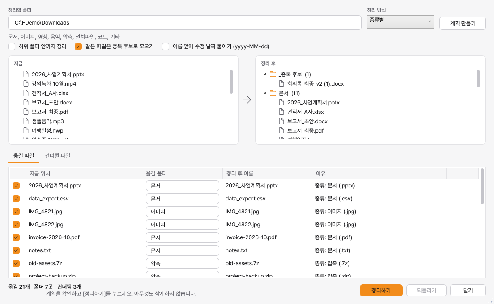

**Git 저장소·개발 프로젝트 폴더**(.git, .sln, package.json 등이 있는 폴더)는 **일부러 정리하지 않습니다.** 파일을 옮기면 빌드나 Git 기록이 깨질 수 있어서, 이런 폴더에서는 아래처럼 빨간 안내 문구만 보이고 정리하기 버튼이 꺼져 있습니다. 프로젝트 밖의 일반 폴더에서 정리하세요. (일반 폴더 안의 프로젝트 폴더는 통째로 그대로 둡니다.)

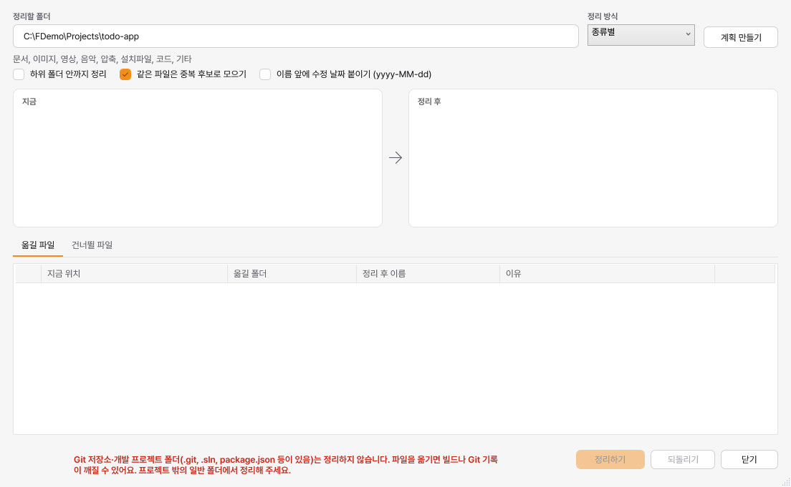

폴더 설명 편집(폴더에 설명 달기)도 같은 도구에 있습니다. 

## 폴더 분석

사이드바의 **폴더 분석**(또는 명령 팔레트)을 누르면 지금 폴더가 있는 드라이브를 분석하는 탭이 열립니다.

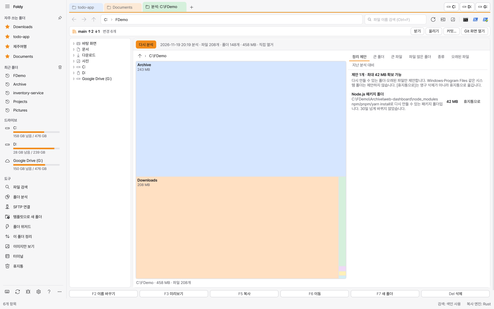

- **트리맵**: 큰 폴더일수록 큰 칸. 칸을 누르면 안으로 들어가고, Backspace·오른쪽 클릭·마우스 뒤로 버튼은 한 단계 위로.
- **목록**: 큰 폴더·큰 파일 순위, 파일 많은 폴더, 종류별, 오래된 파일, 지난 분석보다 늘어난 폴더.
- **정리 제안**: node_modules, 빌드 결과, 임시 파일, 캐시처럼 지워도 다시 만들 수 있는 것만. 시스템 폴더는 절대 제안하지 않고, **[휴지통으로]**는 확인 뒤 휴지통으로만 옮깁니다.
- **F5** 다시 분석, **Esc** 취소.

색인 서비스가 있으면 디스크를 다시 읽지 않고 몇 초 만에 분석하고, 없으면 낮은 우선순위로 직접 훑습니다. 

## 느린 드라이브

회사 보안 드라이브처럼 폴더를 여는 데 오래 걸리는 **네트워크·원격 드라이브**는 Foldy가 열어 본 시간으로 **자동으로** 알아챕니다. 설정은 없습니다.

- 경로바 옆에 **느린 드라이브** 칩이 뜨고, 처음 알아챈 때 한 번 상태줄에 알립니다.
- 목록을 먼저 보여 주고 폴더 크기 같은 것은 나중에 채웁니다. 다른 폴더로 가면 하던 일은 취소됩니다.
- Git 감지, 이미지 썸네일, 파일별 아이콘은 건너뛰고, 미리보기(F3)는 **[미리보기]**를 눌러야 열립니다.
- 폴더 변경은 감시 대신 주기적으로 확인합니다.
- 루트 폴더가 "시스템" 속성이어도(예: K:) 탐색기처럼 **숨김** 속성만 가리고 보여 줍니다.

(느린 드라이브 칩은 실제 느린 드라이브가 있어야 나타나므로 이 문서에는 화면이 없습니다.)

## 설정과 테마

**Ctrl+,**(또는 사이드바 설정)로 엽니다. 일반, 모양, 목록, 터미널, 복사, 업데이트, 단축키 페이지가 있습니다.

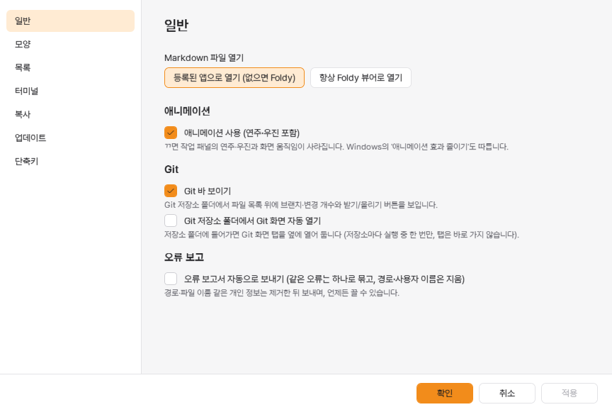

- **테마**: 시스템 설정 따르기(라이트/다크 자동) · 라이트 · 다크 · 레트로. **강조색**: Foldy 오렌지 또는 Windows 강조색.
- **목록 간격**(촘촘하게/보통/널널하게), **숨김 파일 보기**(Ctrl+H)는 사이드바 더 보기에서도 바꿉니다.
- **복사**: 병렬 복사 스레드 수. **업데이트**: 확인 방식. **터미널**: 기본 셸(PowerShell/cmd)과 Windows Terminal 사용.
- **단축키**: 칸을 누르고 새 조합을 누르면 바뀝니다(겹치면 경고). 바꾼 것만 `%LOCALAPPDATA%\Foldy\keymap.json`에 저장됩니다.

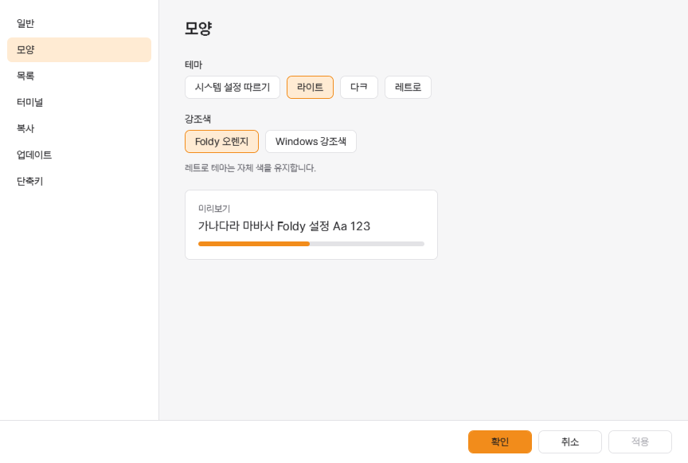

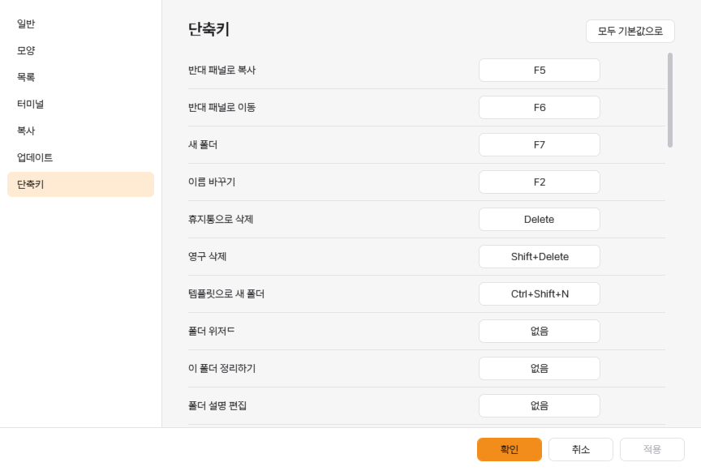

설정과 기록은 `%LOCALAPPDATA%\Foldy`(settings.json, session.json, logs)에, 색인 데이터는 `%ProgramData%\Foldy`에 있습니다. 

## 단축키

모든 명령은 **Ctrl+Shift+P**로 이름을 쳐서 찾을 수 있고, 설정 → 단축키에서 바꿀 수 있습니다.

| 키 | 동작 |
| --- | --- |
| **F1** | 도움말 (사용 설명서) |
| **F2** / **F5** / **F6** / **F7** | 이름 바꾸기 / 복사 / 이동 / 새 폴더 |
| **F3** | 미리보기 창 보이기/숨기기 |
| **Delete** / **Shift+Delete** | 휴지통으로 / 영구 삭제 |
| **Tab** | 다른 패널로 |
| **Ctrl+T** / **Ctrl+W** | 새 탭 / 탭 닫기 |
| **Ctrl+Tab** / **Ctrl+Shift+Tab** | 다음 / 이전 탭 |
| **Alt+←** / **Alt+→** / **Alt+↑** | 뒤로 / 앞으로 / 위로 |
| **Ctrl+L** | 경로 직접 입력 |
| **Ctrl+F** | 파일 이름 검색 |
| **Ctrl+R** | 새로 고침 |
| **Ctrl+H** | 숨김 파일 보이기/숨기기 |
| **Ctrl+B** | 폴더 트리 보이기/숨기기 |
| **Ctrl+Shift+B** | 사이드바 접기/펼치기 |
| **Ctrl+Shift+E** | 사이드바로 포커스 이동 (Esc로 목록 복귀) |
| **Ctrl+Shift+I** | 이미지만 보기 |
| **Ctrl+Shift+N** | 템플릿으로 새 폴더 |
| **Ctrl+Shift+O** | SFTP 서버에 연결 |
| **Ctrl+`** / **Ctrl+Shift+`** | 터미널 / 관리자 터미널 (SFTP 탭에서는 Ctrl+` = SSH) |
| **Ctrl+Shift+P** | 모든 명령 |
| **Ctrl+,** | 설정 |

## 버그 신고와 버그 진단 모드

- 사이드바 아래 **버그 신고**(또는 Foldy 정보 창)는 앱·Windows 버전과 최근 기록을 채운 GitHub 이슈 작성 페이지를 엽니다.
- Foldy는 오류를 자동으로 모아 두고(같은 오류는 한 번만), 처음에 보낼지 묻습니다. 보고서에는 앱·Windows 버전, 오류 내용, 최근 로그만 들어가고 **파일 경로와 사용자 이름은 지웁니다**. 설정 → 일반에서 언제든 끌 수 있습니다. , [PRIVACY.md](PRIVACY.md)
- **버그 진단 모드**: 특정 상황에서만 생기는 문제(예: 네트워크 드라이브가 빈 화면)는 사이드바 맨 아래 ⋯(더 보기) → **버그 진단 모드 켜기/끄기**로 자세한 기록을 남깁니다. 켜면 상태바에 "버그 진단 중"이 보이고, 문제를 다시 재현한 뒤 끄면 기록을 오류 보고서로 보낼지 묻습니다. 24시간 뒤 저절로 꺼집니다. 기록 파일은 ⋯ → **로그 폴더 열기**.

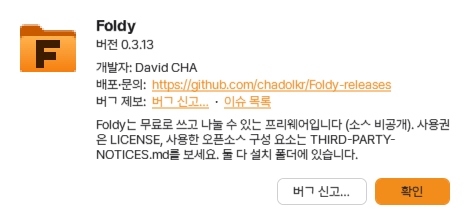

## 자주 묻는 질문

**검색이 현재 폴더만 찾아요.**
색인 서비스가 설치돼 있지 않거나 준비 중입니다. 사이드바 더 보기 → **색인 서비스 설치 (관리자)…**. 첫 색인은 드라이브 크기에 따라 수십 초 걸립니다.

**네트워크 드라이브가 끊겨 있으면 느려지나요?**
아니요. 드라이브마다 따로 일하므로 응답 없는 드라이브가 있어도 다른 탭과 패널은 그대로 움직입니다. 그 탭에서 **Esc**로 불러오기를 취소할 수 있습니다.

**회사 보안 드라이브가 빈 화면이에요.**
루트가 "시스템" 속성이어도 이제 보입니다(탐색기처럼 Hidden만 숨김). 그래도 비면 버그 진단 모드를 켜고 다시 열어 본 뒤 기록을 보내 주세요.

**Foldy를 또 실행하면 창이 두 개 뜨나요?**
아니요. 켜져 있는 창이 앞으로 오고, 경로를 넘겼다면 새 탭으로 열립니다.

**회사망에서 업데이트가 안 돼요.**
사이드바의 **업데이트** 버튼을 눌러 보세요. 서비스가 못 나가도 Foldy가 사용자 프록시로 다시 확인합니다. 그래도 실패하면 이유가 표시됩니다.

**폴더 정리가 안 돼요 ("정리하지 않습니다" 빨간 글씨).**
Git 저장소·프로젝트 폴더는 일부러 정리하지 않습니다. 일반 폴더에서 실행하세요.

**애니메이션(연주·우진)을 끄고 싶어요.**
설정 → 일반 → "애니메이션 사용"을 끄세요.

**삭제한 파일을 되살리고 싶어요.**
Delete는 휴지통으로 보냅니다(사이드바 휴지통에서 열기). Shift+Delete와 SFTP 삭제는 되살릴 수 없어 확인을 한 번 더 묻습니다.

## 개인정보

[PRIVACY.md](PRIVACY.md). Foldy는 사용자가 켜거나 직접 실행한 기능(업데이트 확인, 동의한 오류 보고, SFTP·Git 연결 등)을 빼고는 어떤 정보도 다른 곳으로 보내지 않습니다.

## 라이선스

무료로 쓰고 나눌 수 있는 프리웨어입니다(소스 비공개). [사용권](LICENSE) · [오픈소스 고지](THIRD-PARTY-NOTICES.md) · 개발자 David CHA · <https://github.com/chadolkr/Foldy-releases>
